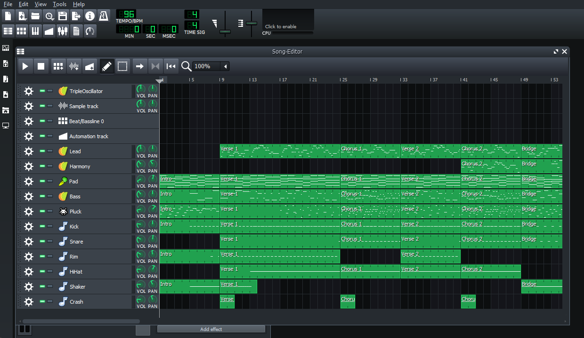

# LMMS Agent Bridge

This gives your AI agent access to [LMMS](https://lmms.io) so it can compose,
arrange, mix, and export music, either working alone or alongside you in the
same project.

The bridge connects any MCP-capable agent to a **running** LMMS session.
The agent works inside the song that is open on your screen: it creates tracks,
writes melodies and drum patterns, loads presets and samples, adjusts the mix,
automates parameters, and renders audio. You can watch, play back, and edit
in LMMS at the same time.



*An arrangement composed and built by an agent through the bridge.*

> [!WARNING]
> **Experimental.** Only **Windows x64** with **LMMS 1.2.2** (the stock
> installer, built against Qt 5.4.2) is supported. The native plugin is built
> for that exact binary interface. It will not load in other LMMS versions or
> on other platforms.

## What your agent can do

- **Compose:** create instrument, sample, automation, and Beat/Bassline tracks;
  write and edit notes in batches; and place patterns across the song.
- **Arrange:** move, resize, duplicate, and rename clips; set the tempo and
  time signature.
- **Sound design:** find and load factory presets, samples, and VST
  instruments, then read and set instrument parameters.
- **Mix:** set volume, pan, mute, and solo; route tracks to mixer channels;
  manage effect chains; and write automation.
- **Listen and export:** play, pause, and seek; render WAV, FLAC, OGG, or
  MP3 audio (solo tracks first to render stems); and export MIDI. Each render
  reports its peak and RMS levels.
- **Collaborate:** open your existing songs, inspect what is already there,
  and build on it. Saving is under your control.

## How it works

```text
AI agent  ──MCP (stdio)──▶  scripts/lmms_mcp.py  ──named pipe──▶  agentbridge.dll (inside LMMS)
```

| Component | Location | Role |
| --- | --- | --- |
| **Native plugin** | `plugin/agentbridge/` | An LMMS tool plugin that edits the live song models and renders audio from within LMMS. |
| **MCP server** | `scripts/lmms_mcp.py` | A Python stdio server that exposes the plugin's commands as validated MCP tools. |
| **Agent skill** | `.agents/skills/lmms-operation-instructions/` | Operating guidance for agents: session safety, musical units, editing, and export. |

> [!IMPORTANT]
> The tools edit the song that is **currently open in LMMS, including unsaved
> changes**. Save your work before handing a song to an agent. The skill
> instructs agents to save before replacing a song and never to discard work
> unless asked. Playback defaults to a conservative **8% master volume**.

## Requirements

- Windows 10/11 x64
- [LMMS 1.2.2 x64](https://github.com/LMMS/lmms/releases/tag/v1.2.2), installed
  to the default `C:\Program Files\LMMS`, or pass a different path to the
  launcher
- Python 3.10 or newer
- [Git for Windows](https://gitforwindows.org/) (provides Git Bash for the build)
- An MCP-capable agent or client

The setup script downloads the pinned MinGW compiler and the LMMS, Qt, and
libsamplerate sources and verifies their SHA-256 hashes. Nothing is installed
into the LMMS program directory.

## Installation

Prebuilt binaries are not published yet, so build the plugin from source.
Run these commands from the repository root.

**1. Clone and create a Python environment** (PowerShell):

```powershell
git clone https://github.com/Jx9x/lmms-mcp-bridge.git lmms-agent-bridge
cd lmms-agent-bridge
py -3 -m venv .venv
& .\.venv\Scripts\python.exe -m pip install -r requirements.txt
& .\.venv\Scripts\python.exe scripts\setup_dependencies.py
```

**2. Build the plugin** (Git Bash):

```bash
./scripts/build-plugin.sh
```

This produces `build/lmms-plugins/agentbridge.dll`.

**3. Launch LMMS with the bridge.** Close any running LMMS first, then
double-click `start-lmms-with-bridge.bat`, or run:

```powershell
powershell -NoProfile -ExecutionPolicy Bypass -File scripts\start-lmms-with-bridge.ps1 -Project "C:\Music\my-song.mmp"
```

`-Project` is optional, and `-LmmsExe` selects a non-default LMMS installation.
Launch LMMS this way whenever you want the agent to connect: starting LMMS
normally does not load the plugin.

## Connect your agent

**1. Register the MCP server.** Use absolute paths to the virtual
environment's Python and to `scripts/lmms_mcp.py`. Most clients accept this
JSON format; check your client's documentation for where to put it.

```json
{
  "mcpServers": {
    "lmms": {
      "command": "C:/path/to/lmms-agent-bridge/.venv/Scripts/python.exe",
      "args": ["C:/path/to/lmms-agent-bridge/scripts/lmms_mcp.py"]
    }
  }
}
```

Optional arguments: `--timeout <seconds>`, `--pipe <name>` (it must match
`LMMS_AGENT_BRIDGE_PIPE` in the LMMS environment), and
`--include-tool <name>` for optional diagnostic tools.

**2. Install the skill.** Copy the
`.agents/skills/lmms-operation-instructions/` folder, including its
`references/` subfolder, into your agent's skills directory. If your agent
does not support skills, give it `SKILL.md` as instructions. The skill does
not need to be installed in the bridge's folder.

**3. Try it.** With LMMS running through the launcher, ask your agent:

> Check the LMMS project info, then write an 8-bar lo-fi hip hop loop at
> 85 BPM with drums, bass, and an electric piano, and play it for me.

To test the connection without an agent:

```powershell
& .\.venv\Scripts\python.exe scripts\bridge_client.py ping
```

## Example requests

- "Load `C:\Music\demo.mmp` and add a countermelody to the second chorus."
- "The kick is buried. Balance the drums against the bass and render stems
  so I can compare them."
- "Write a four-chord progression in D minor on a pad, then arrange an intro,
  verse, chorus, and outro."
- "Export the song as a 24-bit WAV to `C:\Music\exports\final.wav`."

## Troubleshooting

| Symptom | Fix |
| --- | --- |
| `an lmms process is already running` | Save your work and close LMMS normally, then relaunch with the launcher. Only one instance is supported. |
| `agentbridge.dll not found` | Build the plugin (installation step 2). |
| Agent reports the bridge pipe is unavailable | LMMS was not started through the launcher, is still loading, or uses a different pipe name. |
| `lmms executable not found` | Pass `-LmmsExe "D:\Path\To\lmms.exe"` to the launcher. |
| Something else went wrong | Check `runtime/logs/agentbridge.log`. |

If a command times out or the connection drops, the outcome of that edit is
unknown. Ask the agent to inspect the project before retrying; edits are never
retried automatically.

## Known limitations

- Only Windows x64 and LMMS 1.2.2 are supported. Newer LMMS releases
  (1.3/nightly) have a different plugin interface.
- VST loading has been verified only with SyndtSphere (VST2 x64). Other VSTs
  may load, but appearing in a VST scan does not confirm compatibility.
- Full ZynAddSubFX preset loading is not verified.
- Stock LMMS 1.2.2 does not save sample-clip names, so those names are lost
  when the project is reloaded.
- Project, preset, sample, and export paths must be absolute local drive
  paths. Network (UNC) and relative paths are rejected.
- Parameter IDs and track/clip handles are valid only for the current
  session.

## Documentation

| Topic | Document |
| --- | --- |
| Operating LMMS through MCP (for agents) | [Operation skill](.agents/skills/lmms-operation-instructions/SKILL.md) |
| Building and maintaining the plugin | [docs/development.md](docs/development.md) |
| Pipe protocol, MCP adapter, and native invariants | [docs/bridge-reference.md](docs/bridge-reference.md) |
| Offline and live test suites | [docs/testing.md](docs/testing.md) |

## License

The native plugin, MCP server, and agent skill are licensed under the
[GNU General Public License v2.0 or later](LICENSE). The plugin compiles
LMMS source code, which is itself licensed under GPL-2.0-or-later. See
[THIRD_PARTY_NOTICES.md](THIRD_PARTY_NOTICES.md) for upstream components.
The test fixture `tests/fixtures/crunk-demo.mmp` is from LMMS and is licensed
under the Artistic License 2.0 (see `tests/fixtures/LICENSES.TXT`).

LMMS is a separate project and is not affiliated with this one.
